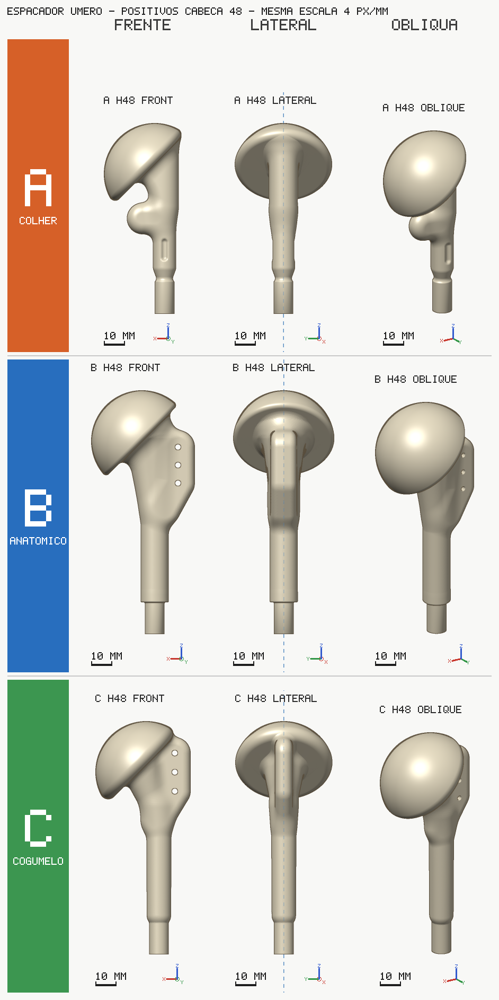
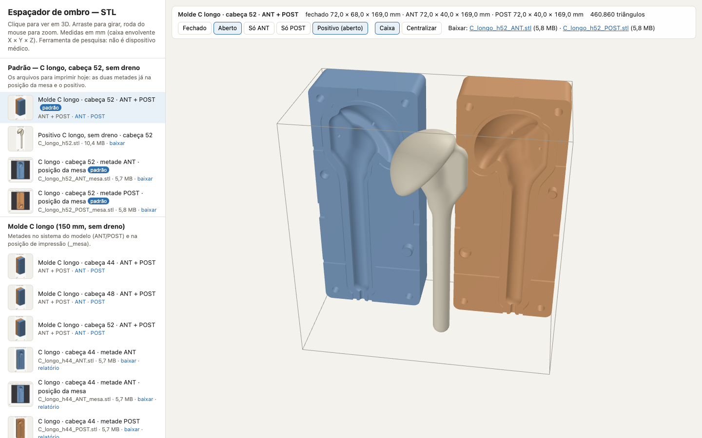
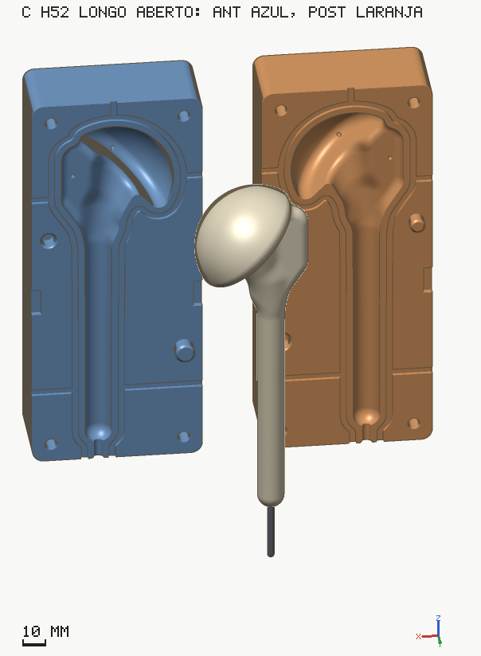
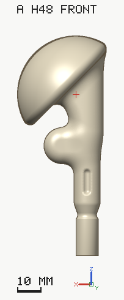
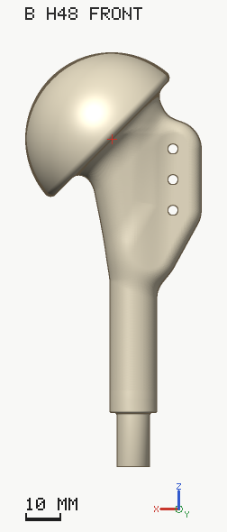
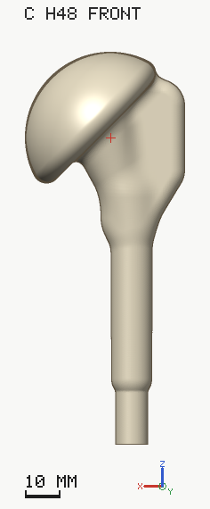
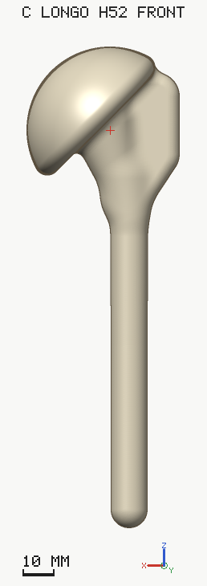
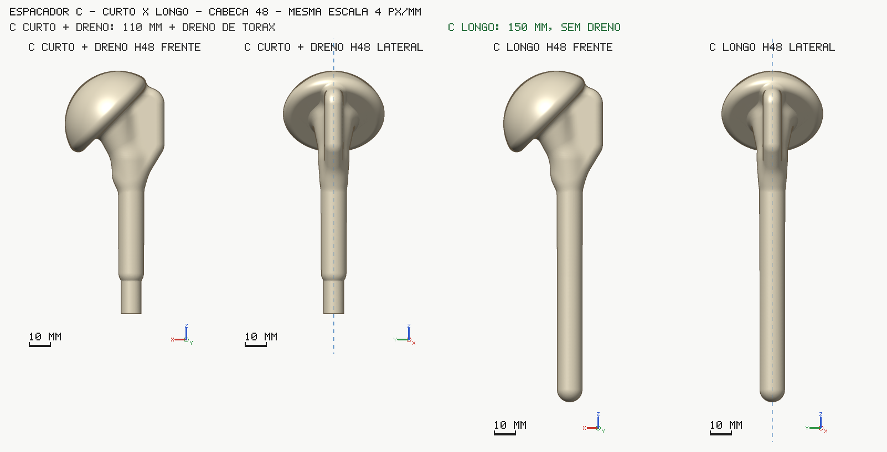

# Espaçador de ombro — positivos e moldes de duas metades

Gerador de **espaçador umeral de cimento ósseo (PMMA) com antibiótico**, para a **revisão em dois tempos
de artroplastia de ombro infectada**. Só o lado do **úmero** (cabeça + corpo + haste). O repositório gera:

- o **positivo**: o sólido do espaçador (STL), em três desenhos (A, B, C) e três cabeças (44, 48, 52 mm);
- o **molde de duas metades** (ANT e POST) para imprimir em casa numa **Bambu Lab A1 mini** e moldar o
  cimento na bancada (técnica aberta, como Klosterman et al. 2021).

> **Ferramenta de pesquisa. NÃO é dispositivo médico certificado.** Nada aqui foi validado para uso em
> paciente. A validação de bancada (cimento real dentro do molde) **ainda não foi feita**. O molde em PETG
> é **só para bancada**. Decisões clínicas são do cirurgião.
>
> Todos os direitos reservados. Sem licença de uso por enquanto (o dono decide depois).



## Visualizador (escolher e baixar os STL)

`visualizador.html` mostra todos os STL da pasta `stl/` em 3D, por tipo, com miniatura, medida (mm) e link
para baixar. Nos moldes, mostra as duas metades **fechadas** ou **abertas** (com o positivo no meio).
Abre no modelo padrão.

```
python3 -m http.server 8000        # na raiz do repositório
# abrir http://localhost:8000/visualizador.html
```

Não abre com duplo clique no arquivo (o navegador bloqueia a leitura dos STL fora de um servidor).
Também funciona no GitHub Pages (só caminhos relativos), mas o Pages **não está ligado**.



## Modelo padrão: C longo, cabeça 52, sem dreno

| Para | Arquivo |
|---|---|
| Imprimir a metade anterior | `stl/padrao/C_longo_h52_ANT_mesa.stl` |
| Imprimir a metade posterior | `stl/padrao/C_longo_h52_POST_mesa.stl` |
| Ver / conferir o espaçador | `stl/padrao/C_longo_h52.stl` (positivo) |

Os geradores abrem nesse modelo: `molde/index.html` começa em "C longo, sem dreno" + cabeça 52;
`node molde/build.mjs` e `node positivo/build.mjs` **sem argumentos** geram o C longo, cabeça 52.
Para o C curto + dreno, passar `--variant short`.



## Os tipos

Todos usam o mesmo contrato de eixos (abaixo), a mesma cabeça esférica e o mesmo colo de 135°.
A, B e C "curto" são só a **parte proximal**: a haste distal é um **dreno de tórax** cheio de cimento
(com fio de aço Ø3,2 dentro), encaixado em z = 0–15 mm. O comprimento final vem do corte do dreno.
O **C longo** é uma **peça única de cimento, sem dreno**.

| Tipo | O que é | Imagem |
|---|---|---|
| **A colher** | Cabeça + corpo fino em forma de colher. Menos cimento. **Sem furos de sutura.** Peça de 90 mm + dreno. |  |
| **B anatômico** | Corpo com forma de metáfise, calcar côncavo, ombro lateral arredondado, 3 furos de sutura. O mais pesado. Peça de 115 mm + dreno. |  |
| **C curto + dreno de tórax** | "Cogumelo com aleta": cabeça, colo, aleta lateral com **3 furos de sutura** (Ø2,5) para o manguito. Peça de 110 mm + dreno 28 Fr. Tem molde pronto. |  |
| **C longo, sem dreno** (padrão) | O mesmo C, 40 mm mais alto: **150 mm** da ponta ao topo da cúpula, haste reta Ø11,5 com ponta arredondada. O fio de aço sai por um furo na ponta do molde. Tem molde pronto. |  |

C curto × C longo na mesma escala: 

Por que o C longo para em 150 mm: a metade do molde mede 8 + 150 + 11 = **169 mm** e precisa imprimir
**reta** na mesa de 180 × 180 mm da A1 mini. Acima de 150 mm o gerador recusa.

Detalhes de cada desenho: `positivo/docs/modelA.md`, `modelB.md`, `modelC.md`.

## Cabeças: 44, 48 e 52 mm

Cada tipo existe nas três cabeças. Os números abaixo são do build (README de `positivo/` e `molde/`).
Densidade do PMMA assumida **1,18 g/cm³** (não verificada); pacote de 40 g contado como 40 g de cimento.

### Positivos (cimento do espaçador)

| Tipo | Cabeça | Volume cm³ | Cimento g | Pacotes 40 g | Peça em Z (mm) |
|---|---|---|---|---|---|
| A colher | 44 | 27,00 | 31,9 | 1 | 90 + dreno |
| A colher | 48 | 32,68 | 38,6 | 1 | 90 + dreno |
| A colher | 52 | 39,36 | 46,4 | 2 | 90 + dreno |
| B anatômico | 44 | 43,90 | 51,8 | 2 | 115 + dreno |
| B anatômico | 48 | 51,04 | 60,2 | 2 | 115 + dreno |
| B anatômico | 52 | 59,77 | 70,5 | 2 | 115 + dreno |
| C curto + dreno | 44 | 32,31 | 38,1 | 1 | 110 + dreno |
| C curto + dreno | 48 | 38,29 | 45,2 | 2 | 110 + dreno |
| C curto + dreno | 52 | 45,60 | 53,8 | 2 | 110 + dreno |
| **C longo** | 44 | 36,95 | 43,6 | 2 | 150 |
| **C longo** | 48 | 42,93 | 50,7 | 2 | 150 |
| **C longo** | **52** | **50,24** | **59,3** | **2** | **150** |

Nos tipos com dreno, o cimento dentro do dreno **não** está na conta. No C longo, todo o cimento está no molde.

### Moldes (cimento na cavidade, com sobra de 30 % para a técnica aberta)

| Molde | Cabeça | Metade X × Y × Z (mm) | Cimento na cavidade | Com sobra 30 % | Pacotes 40 g | Parafuso M5 |
|---|---|---|---|---|---|---|
| C curto + dreno 28 Fr | 44 | 67 × 36 × 131 | 31,4 cm³ ≈ 37 g | ≈ 48 g | 2 | × 65 |
| C curto + dreno 28 Fr | 48 | 69 × 38 × 131 | 37,4 cm³ ≈ 44 g | ≈ 57 g | 2 | × 65 |
| C curto + dreno 28 Fr | 52 | 72 × 40 × 131 | 44,7 cm³ ≈ 53 g | ≈ 69 g | 2 | × 70 |
| C longo | 44 | 67 × 36 × 169 | 36,9 cm³ ≈ 43,6 g | ≈ 57 g | 2 | × 65 |
| C longo | 48 | 69 × 38 × 169 | 42,9 cm³ ≈ 50,7 g | ≈ 66 g | 2 | × 65 |
| **C longo** | **52** | **72 × 40 × 169** | **50,2 cm³ ≈ 59,3 g** | **≈ 77 g** | **2 (justo)** | **× 70** |

Y inclui o pino macho (6 mm). Pacotes com sobra de 30 % (os 2 pacotes do C longo 52 dão 80 g para 77 g).
Só A e B não têm molde neste gerador (só o positivo).

## Contrato de eixos (todos os STL)

- Unidade **mm**. Eixo da haste = **+Z**; ponta distal em **z = 0**; cabeça no topo.
- Cabeça inclinada no plano XZ para **+X = medial** (colo 135°).
- **Y = ântero-posterior.** O sólido é simétrico em y = 0; **y = 0 é o plano de partição** do molde.
  Metade **ANT** em y > 0, **POST** em y < 0; desmolda em ±Y. O mesmo espaçador serve para ombro D e E.
- Toda reta paralela a Y cruza o sólido num intervalo só (sem retenção); o build confere isso.
- Exceção: os arquivos `_mesa.stl` já estão **na posição de impressão** (face de partição para cima,
  centrados na mesa de 180 × 180, comprimento no eixo Y da mesa).

## Pasta `stl/`

| Pasta | Conteúdo |
|---|---|
| `stl/padrao/` | O padrão: `C_longo_h52_ANT_mesa.stl`, `C_longo_h52_POST_mesa.stl` e o positivo `C_longo_h52.stl` |
| `stl/C_longo/` | Molde C longo 44/48/52: `_ANT`, `_POST` (sistema do modelo), `_ANT_mesa`, `_POST_mesa` (para imprimir) e `.json` (relatório) |
| `stl/C_curto_dreno/` | Molde C curto + dreno 28 Fr 44/48/52: `_ANT`, `_POST` e `.json` |
| `stl/positivos/` | Positivos A, B, C (curto), C longo nas 3 cabeças, com `.json` (parâmetros, medidas, validação) |
| `stl/cupons/` | Cupons de calibração: pinos macho e fêmea, furos do dreno 28 Fr |
| `stl/manifest.json` | Lista lida pelo visualizador (`node tools/make_manifest.mjs` refaz) |

Todos os arquivos têm menos de 100 MB (o maior tem ~11 MB). Os STL ficam **só** em `stl/`: as pastas de saída
dos geradores (`positivo/stl/`, `molde/stl/`) estão no `.gitignore`. Os geradores e a página do molde leem os
positivos de `stl/positivos/` quando não há build local.

## Como imprimir na Bambu Lab A1 mini (180 × 180 × 180 mm)

1. **Calibrar a folga primeiro** com os cupons (`stl/cupons/`), no mesmo filamento e perfil do molde.
   A folga dos pinos já escolhida pelo cirurgião no cupom da A1 mini é **0,20 mm por lado** (é o padrão do gerador).
2. Abrir no Bambu Studio o arquivo **`_mesa.stl`** (já vem deitado). **Face de partição para cima**, face externa
   (com as gravações) na mesa. **Não girar** a peça no plano da mesa: o C longo ocupa 169 mm, com 5,5 mm de folga nas pontas.
3. **Uma metade por vez** (duas não cabem lado a lado).
4. **Sem suporte, sem brim.** A cavidade é uma bacia aberta para cima.
5. **PETG**, bico 0,4: 240–250 °C, mesa 70–80 °C, PEI texturizada (na lisa, cola bastão), ventilação 30–50 %.
6. Camada 0,2 mm; na região da cabeça, altura de camada variável 0,08–0,12 mm. "Ironing" só na face de topo
   (a face de partição) para a rebarba ficar fina.
7. Perfil: teste de encaixe — 4 paredes + 15 % giroide; bancada com cimento — **PETG 100 %**
   (C longo 52: ~14,6 h e ~485 g por metade, **estimativa**, não saída de fatiador; as duas metades ~1 kg: conferir o carretel).

**PETG é só bancada.** O centro do PMMA passa de 100 °C ao curar; o PETG amolece a 68–80 °C. Para o centro
cirúrgico seria outro material (PA12 por SLS/MJF) com esterilização validada — ver `research/05_materiais_esterilizacao.md`.

## Uso na bancada, passo a passo (C longo, técnica aberta)

Material: metades ANT + POST, 4 parafusos M5 inox (comprimento na tabela), 4 porcas M5, chave Allen 4 mm,
óleo mineral, pincel, fio de aço Ø3,2, cimento + antibiótico, espátula, chave de fenda larga, alicate de corte,
lâmina e lixa.

1. **A seco**: porcas nas cavidades sextavadas da POST; fechar, apertar os 4 parafusos, abrir pelas fendas
   laterais. Conferir que só fecha de um jeito (pinos de diâmetros diferentes).
2. **Fio**: dobrar o fio sobre o gabarito 1:1 gravado na face externa da POST (reto até o traço da dobra, 14°
   para o lado da cabeça). Deixar o trecho reto **10–20 mm mais comprido** que a face distal.
3. **Desmoldante**: pincelar óleo mineral na cavidade, na face de partição e nos canais. Escorrer o excesso.
4. **Cimento**: misturar com o antibiótico; na fase pastosa, encher **as duas metades** com sobra.
5. **Montar**: deitar o fio no meio-furo da POST; a ponta reta passa pelo furo da parede distal e sai para fora.
   Afundar o trecho dobrado no cimento, apontando para a cabeça.
6. **Fechar**: baixar a ANT (os pinos guiam), parafusos em cruz, aos poucos, até as faces encostarem. Segurar a
   ponta do fio alinhada com o eixo. O excesso sai pelos canais e respiros. Não abrir para "conferir".
7. **Esperar** a cura completa, com margem. O molde esquenta: não segurar a região da cabeça. Se possível,
   registrar a temperatura da parede (termopar).
8. **Abrir**: tirar os parafusos; chave de fenda larga nas fendas lateral e medial, girando devagar.
9. **Acabamento**: cortar o fio rente à ponta e lixar; aparar a rebarba da linha de partição (passa pela calota)
   e os tocos das saídas e respiros; lixar fino sobre a calota. **Pesar a peça.**

C curto + dreno: o passo a passo com o dreno está em `molde/README.md` ("Uso na bancada").

## O que ainda NÃO está verificado

- **Calor do cimento × PETG**: deformação do molde e aderência ao óleo só a bancada responde.
- **Cupom do dreno não foi testado** (só o cupom dos pinos foi impresso e escolhido: 0,20 mm).
- **Densidade do cimento** com antibiótico: 1,18 g/cm³ é premissa; pesar a primeira peça.
- **Nenhum molde foi impresso inteiro nem usado com cimento.**
- Se o cimento pastoso escoa bem pelos canais 3 × 3 mm e respiros Ø2: sem número publicado.
- Tempo e massa de impressão são estimativas, não saída de fatiador.
- Uso clínico exigiria outro material, esterilização validada e caminho regulatório (`research/06_regulatorio.md`).

## Como gerar de novo

Precisa de Node 18+ (testado no 22) e do `manifold-3d` **2.5.1** (versão travada).

```
npm install manifold-3d@2.5.1                      # ou: npm install (usa o package.json)

node positivo/build.mjs                            # padrão: positivo C longo, cabeça 52
node positivo/build.mjs --model all --head 44,48,52 --variant short   # A, B e C curto
node positivo/build.mjs --model C --head 44,48,52 --variant long      # C longo, 3 cabeças

node molde/build.mjs                               # padrão: molde C longo, cabeça 52 (+ _mesa)
node molde/build.mjs --variant long --head 44,48,52
node molde/build.mjs --variant short --head 44,48,52 --fr 28          # C curto + dreno
node molde/build.mjs --variant short --coupons --head 48 --quick      # cupons de calibração

node positivo/test/foundation_test.mjs             # testes do positivo
node molde/test/molde_test.mjs                     # testes do molde (~2–3 min; usa python3 + trimesh se houver)
```

Os builds escrevem em `positivo/stl/` e `molde/stl/` (ignorados pelo git). Para publicar um arquivo novo,
copiá-lo para a pasta certa de `stl/` e rodar `node tools/make_manifest.mjs`.

**Página do gerador de molde** (`molde/index.html`): `python3 -m http.server 8000` na raiz e abrir
`http://localhost:8000/molde/`. Gera o molde no navegador (~1,5 s), mostra fechado/aberto e baixa os STL.

## Estrutura

```
README.md                 este arquivo
visualizador.html         escolher, ver em 3D e baixar os STL
stl/                      todos os STL publicados (+ manifest.json)
positivo/                 gerador dos positivos A, B, C (src/, build.mjs, docs/, render/, test/)
molde/                    gerador do molde de 2 metades (src/, build.mjs, index.html, render/, test/)
research/                 notas de pesquisa (português): artigo, mercado, moldes, requisitos, materiais, regulatório
review/AVALIACAO_FABLE.md avaliação crítica do molde antigo (motivo do gerador atual)
tools/make_manifest.mjs   gera stl/manifest.json
docs/visualizador.png     captura do visualizador
```

## Referências e o que não foi publicado

- Técnica de referência: Klosterman et al., *Arthroscopy Techniques* 2021 — https://pmc.ncbi.nlm.nih.gov/articles/PMC7917196/
  (artigo e vídeo). Os quadros extraídos do vídeo **não** estão aqui (licença CC BY-NC-ND); leitura em `research/01_artigo_referencia.md`.
- Fotos de produtos comerciais usadas como referência de forma **não** estão aqui (direitos dos fabricantes);
  as fontes estão por URL em `research/02_opcoes_comerciais.md`.
- O gerador de molde antigo (`moldapp`, `lib`) não foi publicado: estava congelado e com defeitos
  (`review/AVALIACAO_FABLE.md`). Menções a ele nos documentos são históricas.
- Nenhum dado de paciente está neste repositório.
